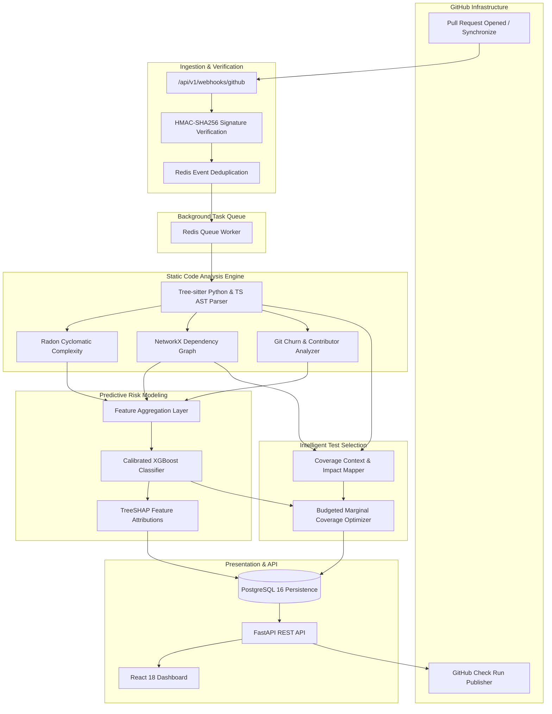

# CodeImpact — Predictive Software Change Risk Analyzer

[](https://github.com/codeimpact/codeimpact/actions/workflows/ci.yml)
[](https://www.python.org/downloads/)
[](https://fastapi.tiangolo.com)
[](https://react.dev)
[](LICENSE)

**CodeImpact** is a developer-infrastructure platform that analyzes GitHub pull requests before merge, reconstructing AST syntax hierarchies, measuring cyclomatic complexity deltas, predicting post-merge regression risk via supervised machine learning, and recommending a budgeted, risk-weighted subset of tests to optimize CI turnaround.

---

## 1. System Architecture



---

## 2. Key Capabilities

- **AST-Level Change Localization**: Tree-sitter maps changed line hunks to function and class nodes.
- **Cyclomatic Complexity Delta**: Radon calculates $\Delta CC$ per modified scope.
- **Dependency Reification**: NetworkX models caller/callee graphs, fan-in, fan-out, and betweenness centrality.
- **Supervised Regression Risk**: Calibrated XGBoost predicting regression probabilities with TreeSHAP explanations.
- **Budgeted Test Selection**: Greedy marginal risk-weighted coverage optimizer recommending tests under developer time budgets.
- **GitHub Check Runs**: Automated status summaries published directly onto pull request review workflows.

---

## 3. Technology Stack

- **Backend**: Python 3.12+, FastAPI, SQLAlchemy 2.0 (asyncpg / psycopg2), Alembic, Pydantic v2, Redis, RQ
- **Static Analysis**: Tree-sitter, tree-sitter-python, tree-sitter-typescript, Radon, NetworkX, GitPython
- **Machine Learning**: Scikit-learn, XGBoost, SHAP, MLflow, Pandas, NumPy, Joblib
- **Frontend**: React 18, TypeScript, Vite, Tailwind CSS, TanStack Query, React Flow, Recharts, Lucide Icons
- **Infrastructure**: Docker, Docker Compose, GitHub Actions, PostgreSQL 16, Redis 7

---

## 4. Repository Structure

```
├── backend/
│   ├── app/
│   │   ├── api/routes/       # REST and Webhook endpoints
│   │   ├── core/             # Config, security, logging, database
│   │   ├── models/           # SQLAlchemy ORM declarative models
│   │   ├── schemas/          # Pydantic v2 validation models
│   │   ├── services/         # Domain services (GitHub, AST, ML, tests)
│   │   ├── workers/          # Background worker queue abstraction
│   │   └── ml/               # Datasets, training, inference, evaluation
│   ├── alembic/              # Database schema versioning migrations
│   ├── tests/                # Unit, integration, security test suites
│   └── pyproject.toml        # Ruff, MyPy, and Pytest configuration
├── frontend/
│   ├── src/
│   │   ├── components/       # Reusable UI widgets
│   │   ├── pages/            # Overview, PR Detail, Impact Graph, Test Intel
│   │   └── App.tsx           # Application shell & route setup
│   └── package.json          # Vite + React + Tailwind dependencies
├── datasets/                 # Historical PR dataset specifications & manifests
├── docs/                     # Comprehensive architecture and engineering specifications
├── scripts/                  # Bootstrapping, training, evaluation, benchmark utilities
├── docker-compose.yml        # Orchestration for PostgreSQL, Redis, Backend, Worker, UI
└── plan.md                   # Phased execution roadmap and verification gates
```

---

## 5. Quick Start (Local Development)

### Prerequisites
- Python 3.12+
- Node.js 20+
- Docker & Docker Compose (optional, for containerized run)

### Running with Docker Compose
```bash
# Clone the repository
git clone https://github.com/codeimpact/codeimpact.git
cd codeimpact

# Launch PostgreSQL, Redis, Backend, Worker, and Frontend
docker compose up --build
```
Access points:
- **Web Dashboard**: [http://localhost:5173](http://localhost:5173) or [http://localhost:80](http://localhost:80)
- **FastAPI Interactive Docs**: [http://localhost:8000/api/v1/docs](http://localhost:8000/api/v1/docs)
- **Health Check Probe**: [http://localhost:8000/api/v1/health](http://localhost:8000/api/v1/health)
- **Prometheus Metrics**: [http://localhost:8000/api/v1/metrics](http://localhost:8000/api/v1/metrics)

### Running Locally without Docker

1. **Start Backend**:
```bash
python3 -m venv .venv
source .venv/bin/activate
pip install -r backend/requirements-dev.txt

# Run migrations (or use SQLite test database)
cd backend
alembic upgrade head

# Start API server
uvicorn app.main:app --reload --port 8000
```

2. **Start Frontend**:
```bash
cd frontend
npm install
npm run dev
```

---

## 6. Testing & Quality Verification

### Run Backend Tests & Coverage
```bash
cd backend
pytest --cov=app --cov-report=term-missing tests/
```

### Run Ruff Linter & Formatting
```bash
cd backend
ruff check .
ruff format --check .
```

### Run MyPy Static Type Checking
```bash
cd backend
mypy app
```

### Run Frontend Tests & Build
```bash
cd frontend
npm test
npm run build
```

---

## 7. Current Project Status

- [x] **Phase 1 — Project Foundations**: Monorepo layout, FastAPI backend, SQLAlchemy 2.0 models, Alembic migrations, Redis queue manager, React + TypeScript frontend, Docker Compose, structured JSON logging, CI workflow, and passing test suites.
- [ ] **Phase 2 — GitHub Integration**: GitHub App, Webhook HMAC-SHA256 signature verification, delivery deduplication, PyGithub client.
- [ ] **Phase 3 — Static Code Analysis Engine**: Tree-sitter AST parsing, Radon complexity deltas, NetworkX dependency graphs.
- [ ] **Phase 4 — Historical Dataset Collection**: Multi-tier regression labeling methodology and chronological split manifests.
- [ ] **Phase 5 — Regression Risk Prediction**: Calibrated XGBoost model training and SHAP local attributions.
- [ ] **Phase 6 — Intelligent Test Selection**: Budgeted greedy marginal coverage optimizer and benchmark evaluations.
- [ ] **Phase 7 — Complete REST APIs**: Idempotent analysis execution, pagination, and OpenAPI specification.
- [ ] **Phase 8 — React Dashboard**: React Flow dependency visualization, risk gauges, and test recommendations.
- [ ] **Phase 9 — GitHub Checks Integration**: Informational Check Run summary publisher.
- [ ] **Phase 10 — Security Hardening & Observability**: Git sanitization, rate limiting, and structured telemetry.
- [ ] **Phase 11 — Comprehensive Testing**: End-to-end webhook-to-dashboard tests and failure injection suites.
- [ ] **Phase 12 — Benchmarks & Empirical Evaluation**: Predictive model and test selection ablation benchmarks.
- [ ] **Phase 13 — Production Deployment**: Multi-stage hardened containers and demo bootstrapping.
- [ ] **Phase 14 — Complete Documentation**: In-depth technical guides and case studies.
