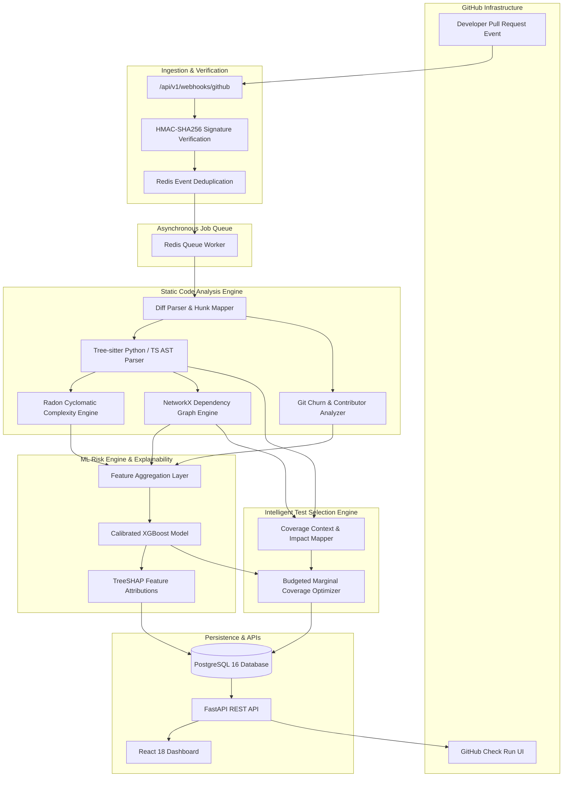

# CodeImpact Architecture Specification

## 1. System Overview
CodeImpact is an intelligent pull request analysis and test optimization platform. It bridges static abstract syntax tree (AST) inspection, dependency graph theory, supervised machine learning, and dynamic test selection into an integrated developer tool.

## 2. Key Subsystems

### A. Webhook Intake & Verification
- **Endpoint**: `POST /api/v1/webhooks/github`
- Verifies `X-Hub-Signature-256` using HMAC-SHA256 against `GITHUB_WEBHOOK_SECRET`.
- Deduplicates using Redis key `gh_delivery:{X-GitHub-Delivery}` with a 24-hour TTL.
- Dispatches analysis job to Redis Queue (`RQ`).

### B. Static Code Analysis Engine
- **Tree-sitter**: Parses the AST of changed files on base and head revisions. Maps changed line intervals to exact enclosing AST node scopes (`function_definition`, `class_definition`).
- **Radon**: Computes Cyclomatic Complexity (CC) and Halstead metrics. Measures $\Delta CC$ per function.
- **NetworkX**: Reconstructs import chains and function calls into a directed graph $G = (V, E)$. Calculates:
  - In-degree (fan-in / callers)
  - Out-degree (fan-out / callees)
  - Betweenness Centrality:
    $$C_B(v) = \sum_{s \neq v \neq t} \frac{\sigma_{st}(v)}{\sigma_{st}}$$

### C. Predictive Risk Engine
- Tabular feature vector fed into an ensemble model (XGBoost / Random Forest).
- Produces continuous risk probability calibrated via isotonic regression or Platt scaling.
- Generates SHAP values for local explainability.

### D. Test Selection Engine
- Solves a budgeted coverage problem:
  $$\max \sum_{i \in \text{Changed}} w_i \cdot \mathbb{I}(\text{covered by } S) \quad \text{subject to} \quad \sum_{t \in S} \text{cost}(t) \le B$$
  where $w_i$ is risk weight, $t$ is candidate test, and $B$ is execution time budget.
